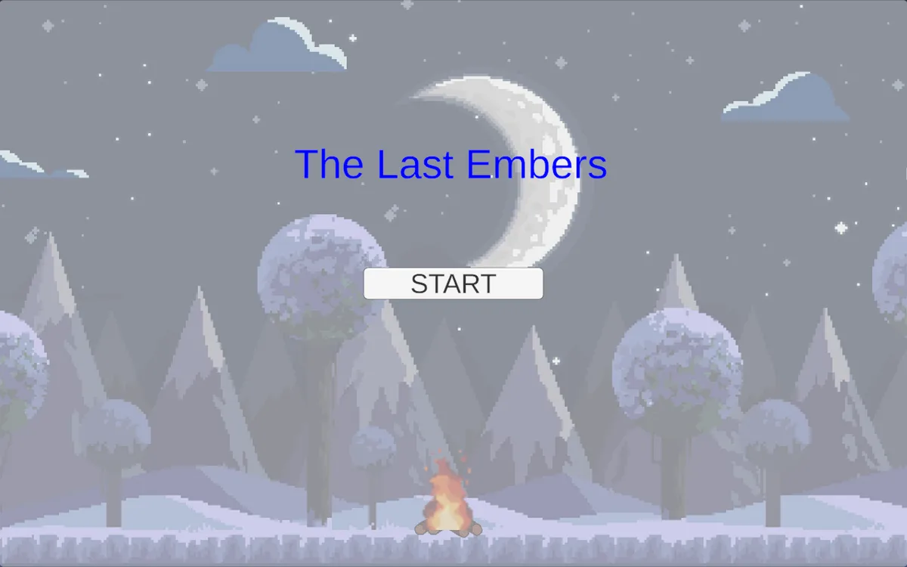

# The Last Ember 🔥

**The Last Ember** is an atmospheric 2D survival/reflection game developed in Unity (C#). The game revolves around the delicate responsibility of keeping a small campfire alive against unpredictable elements, serving as a poignant metaphor for preserving inner drive, motivation, and resilience through life's challenges.

---

## 🌌 Core Concept & Metaphor

The gameplay is designed to evoke feelings of fragility, care, and perseverance:
* **The Campfire:** Symbolizes inner motivation, determination, and life drive.
* **Wind Events:** Represent unexpected obstacles and life's challenges that threaten to extinguish your focus.
* **Log Gathering:** Represents the active effort and care required to maintain resilience.

---

## 🎮 Game Mechanics & Features

* **Tactile Gameplay:** Drag-and-drop mechanics for placing logs into the fire, giving a tangible sense of responsibility.
* **Dynamic Risk & Reward:** Random wind events sweep across the screen, diminishing the flame and requiring immediate player action.
* **Time Pressure:** A 3-minute survival timer creates focused tension and emotional engagement.
* **Audiovisual Feedback:** Dynamic fire sprite intensity changes according to flame health, paired with fire crackling and wind audio cues.

---

## 💻 Tech Stack & Assets

* **Engine:** Unity (2D)
* **Language:** C#
* **Input System:** Unity 2D Physics & Drag-and-Drop system
* **Assets:** Custom 2D Sprites, AudioClips (Fire Crackling & Wind Sounds)

---

## 🚀 Getting Started

### Prerequisites

* **Unity Engine:** Version 2021.3 LTS or higher recommended.

### How to Play / Run

1. Clone or download this repository.
2. Open the project folder using **Unity Hub**.
3. Load the main scene located under `Assets/Scenes/`.
4. Press the **Play** button in the Unity Editor to start.

---

## 👤 Developer

* **Okan Umut Özen**